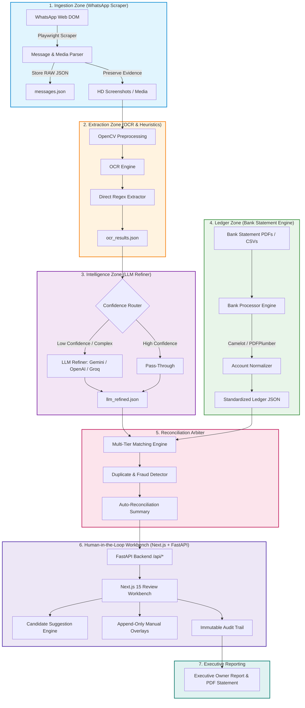

# <p align="center">⚡ FinAudit AI | Next-Gen Multi-Modal Financial Intelligence & Audit Engine ⚡</p>

<p align="center">
  <strong>Autonomous Payment Ingestion, Dual OCR/LLM Extraction, Deterministic Bank Ledger Parsing, and Multi-Tier Reconciliation Workbench</strong>
</p>

<p align="center">
  
  
  
  
  
  
  
  
</p>

---

## 🚀 Overview & Key Highlights

In high-volume peer-to-peer (P2P), merchant, and remittance ecosystems, operators receive thousands of payment screenshots daily across communication channels like WhatsApp. Manual verification against official bank accounts is agonizingly slow, prone to oversight, and highly susceptible to **forged receipts, recycled transaction IDs (UTRs), and duplicate claims**.

**FinAudit AI** solves this with an **end-to-end, multi-stage, zero-trust verification pipeline**:

```
 ┌─────────────────┐       ┌─────────────────┐       ┌─────────────────┐
 │ 1. Ingestion    │ ───►  │ 2. Dual Extract │ ───►  │ 3. Bank Parser  │
 │ WhatsApp Web    │       │ OCR + LLM Intel │       │ PDF / CSV Ledger│
 └─────────────────┘       └─────────────────┘       └─────────────────┘
                                                              │
 ┌─────────────────┐       ┌─────────────────┐                ▼
 │ 6. Owner Report │ ◄───  │ 5. Review UI    │ ◄───  ┌─────────────────┐
 │ Executive Audit │       │ Next.js Ranking │       │ 4. Arbiter      │
 └─────────────────┘       └─────────────────┘       │ Multi-Tier Match│
                                                     └─────────────────┘
```

- 🕵️ **Real-Time WhatsApp Ingestion**: Automated, resumable scraper capturing messages, timestamps, sender profiles, and full-resolution screenshot media.
- 👁️ **Hybrid Computer Vision & OCR**: Image thresholding, contrast enhancement, and multi-engine OCR (PaddleOCR / EasyOCR / Tesseract) extracting raw transaction tokens.
- 🧠 **Dual-Brain Entity Refinement**:
  - **Fast Heuristic Extractor**: Direct pattern matching for instantaneous UTR, UPI, Amount, and Date discovery.
  - **LLM Intelligence Router**: Structured JSON generation powered by Gemini, GPT-4o, Claude 3.5, or Groq with confidence scoring and self-healing schema normalization.
- 🏦 **Deterministic Bank Statement Standardization**: Extracts and normalizes complex tabular statement PDFs (Yes Bank, HDFC, ICICI, SBI) and Google Pay exports into standardized daily transaction ledgers.
- ⚖️ **Multi-Tiered Reconciliation Arbiter**: Links payment claims against official bank ledger rows using exact reference matching, tokenized fuzzy sender-name matching, amount windows, and timestamp tolerances.
- 🛡️ **Anti-Fraud & Duplicate Prevention**: Automatically flags duplicate UTRs across dates/groups, detects recycled transaction screenshots, and isolates altered amounts.
- 🖥️ **Interactive Operator Workbench (Next.js 15 + Tailwind + FastAPI)**:
  - Side-by-side evidence viewer with zoom and metadata inspector
  - **AI Candidate Ranking**: Intelligently scores and ranks potential bank statement matches for unmatched claims
  - **Non-Destructive Overlays**: Append-only manual corrections and overrides without altering immutable raw upstream evidence
- 📊 **Executive & Owner Reporting**: Generates comprehensive daily settlement reports, discrepancy audits, and printable statements for administrative submission.

---

## 🏗️ System Architecture & Data Flow



---

## 🗂️ Date-First Immutable Storage Architecture

The system uses a strict **Date-First Architecture** (`data/{YYYY-MM-DD}/`) ensuring complete temporal isolation, crash safety, and compliance-grade auditability:

```text
data/
└── {YYYY-MM-DD}/                           # Root Date Scope
    ├── whatsapp/
    │   └── {group_name}/
    │       ├── messages.json              # Raw Ingested Chat Metadata
    │       ├── img_001.jpg                # Full-Resolution Transaction Screenshot
    │       ├── ocr_results.json           # Raw OCR Tokens & Heuristic Extractions
    │       └── llm_refined.json           # AI-Refined Canonical JSON Data
    ├── statements/
    │   ├── YES_BANK_0913.json             # Normalized Bank Ledger (YES Bank)
    │   ├── HDFC_CORP_4821.json            # Normalized Bank Ledger (HDFC)
    │   └── gpay-PRIMARY_0000.json         # Normalized Google Pay Ledger
    └── reconciliation/
        ├── ocr_reconciliation.json        # Auto Phase-1 Matching Artifact
        ├── final_reconciliation.json      # Auto Phase-2 Matching Artifact
        ├── manual_reconciliation.json     # Non-Destructive Manual Operator Links
        ├── manual_corrections.json        # Field Correction Patches (Applied at Read)
        └── review_actions.json            # Append-Only Event & Audit Log
```

> **🛡️ Zero-Destruction Guarantee:** Raw evidence is NEVER overwritten. Manual corrections and matches are stored as append-only event streams merged dynamically at runtime.

---

## ⚡ Core Modules & Features

### 1. 🌐 Ingestion Zone (`core/ingestion/` & `apps/scrape.py`)
- **Headless & Visible Playwright Automation**: Robust WhatsApp Web session controller.
- **Resumable Extraction**: Remembers message markers; recovers instantly upon network blips.
- **Media Preservation**: Captures pristine HD images, audio voice notes, and contextual reply quotes.

### 2. 🔍 Computer Vision & Direct OCR (`core/processing/` & `apps/run_ocr.py`)
- **Adaptive Image Preprocessing**: Grayscale filtering, contrast equalization, and noise removal.
- **Multi-Engine Pipeline**: PaddleOCR, Tesseract, and EasyOCR fallbacks.
- **Direct Heuristic Parser**: Regex mining for 12-digit Indian Financial System UTRs, UPI Reference IDs, ₹ Amounts, and Timestamps.

### 3. 🧠 LLM Intelligence Refiner (`core/intelligence/` & `apps/run_refiner.py`)
- **Multi-Provider Support**: Pluggable backends for **Google Gemini (Flash / Pro)**, **OpenAI (GPT-4o / GPT-4o-mini)**, **Groq (Llama-3)**, and **Anthropic (Claude 3.5)**.
- **Batch Processing & Token Optimization**: Batches noisy OCR text into structured JSON schemas.
- **Self-Healing Normalization**: Cleans OCR character misreads (e.g., `O` vs `0`, `I` vs `1`, currency symbol variations).

### 4. 🏦 Deterministic Bank Processor (`core/ledger/` & `apps/run_bank_processor.py`)
- **Multi-Bank Format Parsers**: Native extractors for Yes Bank, HDFC, ICICI, SBI, Axis, Kotak, and Google Pay Business.
- **Hybrid PDF Extraction**: Combines `pdfplumber`, `camelot-py`, and OCR for non-selectable scanned PDFs.
- **Narrative Classifier**: Dissects complex bank statement strings into Payer Name, Bank UPI Reference, Remitter Account, and Mode (IMPS/NEFT/UPI/RTGS).

### 5. ⚖️ Matching Arbiter & Anti-Fraud Engine (`core/reconciliation/`)
- **Multi-Tier Matching**:
  - **Tier 1 (Exact UTR Match)**: 100% confidence link on 12-digit reference.
  - **Tier 2 (Amount + Fuzzy Name + Time Window)**: Tokenized name similarity scoring (`SequenceMatcher` + token intersections) within configured time tolerances.
  - **Tier 3 (Account-Level Routing)**: Segregates deposit vs withdrawal streams.
- **Fraud & Duplicate Prevention**: Flags recycled screenshots, double-claimed transactions, and timestamp anomalies.

### 6. 🖥️ Interactive Review Dashboard (`frontend/` & `apps/review_api.py`)
- **Modern Next.js 15 UI**: Built with React 19, TypeScript, TanStack React Query, and Tailwind CSS.
- **Candidate Suggestion Engine**: Automatically ranks top bank statement matches for unverified claims with confidence badges.
- **Side-by-Side Verification**: Inspect high-res receipt images right next to bank statement rows.
- **Field Patching & Overrides**: Correct OCR misread amounts or UTRs on the fly with reversible audit logging.

### 7. 📊 Executive Reporting (`core/review/report_service.py`)
- Generates clean operational summaries with total volume, matched counts, unmatched amounts, and flagged fraud cases.
- Exportable and printable daily accounting reconciliation sheets.

---

## 🛠️ Tech Stack & Prerequisites

| Layer | Technologies |
| :--- | :--- |
| **Backend & Core** | Python 3.10+, FastAPI, Pydantic v2, Uvicorn, Playwright |
| **Data & Financial Processing** | Camelot-py, pdfplumber, OpenCV, NumPy, Pandas, Loguru |
| **OCR & AI Extraction** | PaddleOCR, Tesseract, EasyOCR, Google Gemini API, OpenAI API, Groq |
| **Frontend Dashboard** | Next.js 15.1, React 19, TypeScript, Tailwind CSS, TanStack Query |
| **State & Artifacts** | Date-Partitioned Atomic JSON Filesystem, Append-Only Event Logs |

---

## 🚀 Quick Start Guide

### 1. Clone & Configure Environment

```bash
# Clone the repository
git clone https://github.com/your-username/finaudit-ai.git
cd finaudit-ai

# Create and activate Python virtual environment
python -m venv .venv
# On Windows PowerShell:
.\.venv\Scripts\Activate.ps1
# On Linux/macOS:
source .venv/bin/activate

# Install Python dependencies
pip install -r requirements.txt
playwright install chromium
```

### 2. Configure Settings & Secrets

Create a `config.json` in the root directory (never commit this file):

```json
{
  "ENVIRONMENT": "production",
  "LLM_PROVIDER": "gemini",
  "GEMINI_API_KEY": "YOUR_GEMINI_API_KEY_HERE",
  "OPENAI_API_KEY": "YOUR_OPENAI_API_KEY_HERE",
  "GROQ_API_KEY": "YOUR_GROQ_API_KEY_HERE",
  "DATA_DIR": "./data",
  "INPUT_STATEMENTS_DIR": "./input_statements",
  "SCRAPER": {
    "HEADLESS": false,
    "BROWSER_TIMEOUT_MS": 60000,
    "SCROLL_DELAY_MS": 1200
  },
  "RECONCILIATION": {
    "TIME_TOLERANCE_HOURS": 24,
    "FUZZY_NAME_THRESHOLD": 0.75
  }
}
```

### 3. Setup Frontend Dashboard

```bash
cd frontend
npm install
npm run build
```

---

## 💻 Running the Pipeline

### Step 1: Ingest WhatsApp Chat & Screenshots
```bash
# Scrapes designated WhatsApp groups for a specific date
python apps/scrape.py --group "Main Payment Group" --date 2026-08-22
```

### Step 2: Run Computer Vision & OCR
```bash
# Extracts raw text and heuristic markers from all downloaded screenshots
python apps/run_ocr.py --date 2026-08-22
```

### Step 3: Run LLM Intelligence Refiner
```bash
# Refines noisy OCR outputs into validated structured JSON
python apps/run_refiner.py --date 2026-08-22
```

### Step 4: Ingest & Parse Bank Statements
```bash
# Drop your PDF / CSV bank statements in ./input_statements/ and process:
python apps/run_bank_processor.py --date 2026-08-22
```

### Step 5: Execute Automated Reconciliation
```bash
# Run auto-matching arbiter across claims and bank statement ledgers
python apps/reconcile.py --date 2026-08-22 --phase final
```

### Step 6: Launch Review Dashboard & Backend
```bash
# Start FastAPI backend (port 8000)
python apps/review_api.py

# In a separate terminal, start Next.js frontend (port 3456)
cd frontend
npm run dev
```

Visit **`http://localhost:3456`** in your browser to access the interactive review workbench!

---

## 📊 Pipeline Comparison Table

| Metric / Capability | ❌ Manual Auditing | ⚠️ Basic Regex Bots | ⚡ FinAudit AI Platform |
| :--- | :--- | :--- | :--- |
| **Speed (1,000 claims)** | 6 - 8 Hours | 15 - 20 Minutes | **< 60 Seconds** |
| **Noisy Screenshot Handling** | High Human Fatigue | Fails on font/layout changes | **Dual CV + LLM Self-Healing** |
| **Bank Statement Parsing** | Manual CSV cross-check | Broken by multi-page PDFs | **Multi-bank deterministic engine** |
| **Fraud & Duplicate Detection** | High Risk of Oversight | Basic exact matches only | **Cross-date UTR & fuzzy detection** |
| **Candidate Ranking** | None | None | **Algorithmic top-N ranked match cards** |
| **Audit Provenance** | None | Overwrites data | **100% Immutable Append-Only Event Trail** |

---

## 🛡️ Security & Privacy Notice

- **Financial Data Isolation**: All raw images, bank statement PDFs, and financial ledgers are kept inside local date-partitioned storage (`data/` and `input_statements/`), which are strictly excluded via `.gitignore`.
- **Zero Raw Data in Commits**: Never commit client bank records, customer phone numbers, or active session cookies to public repositories.
- **Redaction Ready**: The LLM prompt builder includes automated token masking for non-essential PII.

---

## 🤝 Contributing & Community

Contributions, feature requests, and issue reports are warmly welcomed!

1. Fork the Project
2. Create your Feature Branch (`git checkout -b feature/AmazingFeature`)
3. Commit your Changes (`git commit -m 'Add some AmazingFeature'`)
4. Push to the Branch (`git push origin feature/AmazingFeature`)
5. Open a Pull Request

---

## 📄 License

Distributed under the **MIT License**. See `LICENSE` for more information.

<p align="center">
  Made with ❤️ for high-throughput, fraud-proof financial operations.
</p>
